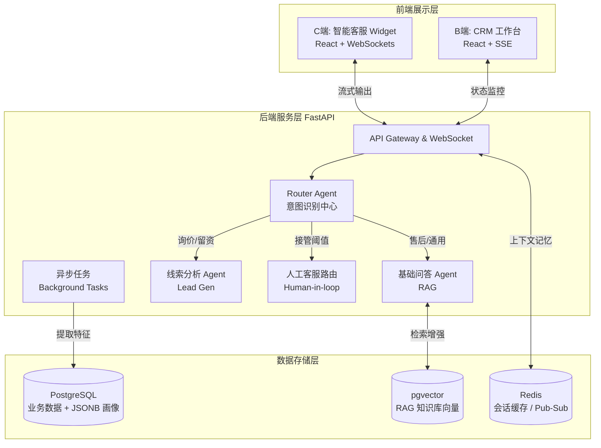

---

```markdown
# 🤖 AI Customer Service & CRM System


本项目是一个具备销售线索挖掘（Lead Generation）功能的 AI 客服与 CRM 整合系统。采用 **FastAPI + PostgreSQL (pgvector) + Redis + React (Vite)** 的现代化 AI 应用技术栈，兼顾开发效率与 AI 向量检索的高并发需求。

## 📑 目录
- [架构概览](#-架构概览)
- [技术栈详情](#-技术栈详情)
- [核心业务逻辑](#-核心业务逻辑)
- [项目目录结构](#-项目目录结构)
- [开发路线图 (Roadmap)](#-开发路线图-roadmap)
- [风险与兜底策略](#-风险与兜底策略)

---

## 🏗 架构概览

本系统采用前后端分离架构，结合大语言模型 (LLM) 和多 Agent 协同流转机制。



---

## 💻 技术栈详情

### 1. 前端 (React + Vite)

* **C端侧 (Chat Widget):** 轻量级悬浮窗组件，通过 WebSocket 与后端保持长连接，实现流式输出（Streaming）打字机效果，提升用户体验。
* **B端侧 (Admin/CRM Dashboard):** 供人工客服和销售使用。提供实时监控会话、接管对话（Human-in-the-loop）、查看用户动态画像和线索评分的工作台。

### 2. 后端 (FastAPI)

* **API Gateway & WebSocket Server:** 处理 HTTP 请求和实时 WebSocket 通信。FastAPI 的异步特性极大地优化了 LLM 的高延迟网络请求。
* **Agent 调度中心 (Agent Orchestrator):** 管理多 Agent 状态机，负责意图分发。
* **后台任务 (Background Tasks):** 针对线索打分、画像提取等不需要实时阻塞用户对话的任务，通过异步队列处理。

### 3. 数据层 (PostgreSQL + pgvector + Redis)

* **PostgreSQL:** 存储关系型数据（用户表、会话记录、线索状态等），利用 `JSONB` 字段灵活存储动态增加的画像标签。
* **pgvector:** 作为轻量级向量数据库，存储企业知识库切片的 Embedding，用于 RAG 检索。
* **Redis:** * **缓存:** 存储高频通用问题。
* **会话管理:** 存储活跃对话上下文（Context Memory）。
* **Pub/Sub:** 实现 AI 触发人工转接时，向在线客服推送实时通知。


---

## 🧠 核心业务逻辑

### 1. 多 Agent 协同与人工路由

* **意图识别 Router Agent:** 充当入口，分析用户输入并进行分类。
* **流转机制:**
* `售后咨询` ➔ 路由至 **基础问答 Agent**（查询 pgvector 知识库）。
* `产品询价/高意向` ➔ 路由至 **线索分析 Agent**（引导留资）。
* `触发敏感词 / 连续未解决 / 要求人工` ➔ 触发 **人工路由模块**，通过 Redis Pub/Sub 通知 B 端客服面板接管。


### 2. 动态画像 (Persona) 与 个性化 RAG

* **画像构建 (异步):** 会话结束后，后台触发 LLM 提炼对话标签（如：*预算充足、关注隐私*），更新至 PostgreSQL 的 JSONB 字段。
* **个性化回复:** 再次提问时，系统组合 `[用户问题] + [检索知识] + [画像标签]` 作为 Prompt 发送给 LLM，实现定制化语气与策略。

### 3. 线索打分 (Lead Scoring) 体系

采用混合打分机制（Rule-based + LLM）：

* **静态行为:** 访问定价页 (+10分)，注册 (+20分)，留资 (+50分)。
* **动态对话:** LLM 评估对话意图（如询问批量折扣给 +30分）。
* **触发边界:** 总分 `> 80分` 变更为 **Hot Lead**，在 CRM 面板标红并强制提醒销售介入。

---

## 📂 项目目录结构

采用领域驱动设计 (DDD) 的模块化结构：

```text
project_root/
├── frontend/                  # React + Vite 前端代码 (C端 & B端)
├── backend/                   # FastAPI 后端核心
│   ├── app/
│   │   ├── api/               # 路由定义 (WebSockets, HTTP REST)
│   │   ├── core/              # 核心配置 (Config, DB/Redis连接)
│   │   ├── models/            # SQLAlchemy 数据模型 (含 pgvector)
│   │   ├── schemas/           # Pydantic 验证模型 (Request/Response)
│   │   ├── services/          # 业务逻辑服务
│   │   │   ├── agents/        # 多 Agent 逻辑 (Router, QA, LeadGen)
│   │   │   ├── rag/           # 向量化、检索逻辑
│   │   │   └── scoring/       # 线索打分算法
│   │   └── main.py            # FastAPI 启动入口
│   ├── requirements.txt
│   └── docker-compose.yml     # 容器化编排 (Postgres+pgvector, Redis)
└── README.md

```

---

## 🗺 开发路线图 (Roadmap)

| 阶段 | 周期 | 目标 | 核心功能 |
| --- | --- | --- | --- |
| **Phase 1** | 第1-2周 | **核心闭环 (MVP)** | 跑通 FastAPI + WebSocket；完成文档向量化与 pgvector 入库；实现基础 RAG 问答 Agent。 |
| **Phase 2** | 第3-4周 | **智能路由与线索** | 引入 Router Agent 意图识别；建立基础线索打分逻辑；完成 Redis 上下文会话缓存。 |
| **Phase 3** | 第5-6周 | **客服工作台与画像** | 开发 React CRM 前端；打通 Redis Pub/Sub 人工接管机制；实现异步画像提取与数据库写入。 |

---

## 🛡 风险与兜底策略

* 🔴 **AI 回答幻觉 (Hallucination)**
* **兜底:** 严格设定 pgvector 的检索距离阈值（Distance Threshold）。若相关度极低，强制 AI 降级回复：“目前没有相关资料，已为您转接人工客服。”


* 🔴 **系统响应延迟**
* **兜底:** 前后端全面采用 WebSocket 或 SSE 进行**流式输出 (Streaming)**。确保首字响应时间极短，利用打字机效果缓解用户等待焦虑。


* 🔴 **潜在客户漏判或误判**
* **兜底:** 允许用户主动点击界面上的“联系商务”物理按钮，直接绕过 AI 评分建立高优先级工单。


```

***

这份 README 已经为你搭建好了门面。接下来，你是想让我先为你输出 **PostgreSQL (pgvector) 的数据库表结构定义（SQLAlchemy 模型代码）**，还是直接进入 **FastAPI 的多 Agent 路由代码** 的编写？

```
