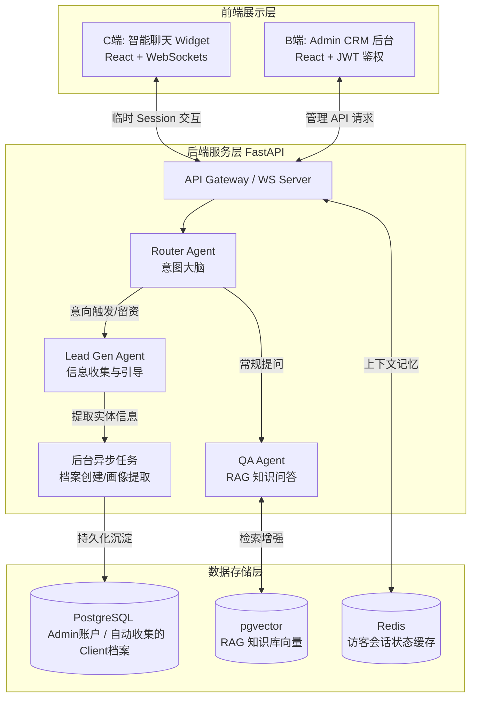

# 🤖 AI Sales & CRM System (Auto Lead Generation)


本项目是一个由 AI 全自动驱动的销售线索挖掘与 CRM 管理系统。采用 **FastAPI + PostgreSQL (pgvector) + Redis + React (Vite)** 技术栈。系统主要由 **全能 AI 客服** 负责面向 C 端访客的接待与信息收集，自动将访客转化为高价值客户（Clients），供 B 端管理员（Admin）在后台统一管理与异步跟进。

## 📑 目录
- [业务角色与架构](#-业务角色与架构)
- [核心业务逻辑](#-核心业务逻辑)
- [项目目录结构](#-项目目录结构)
- [开发路线图 (Roadmap)](#-开发路线图-roadmap)

---

## 🏗 业务角色与架构

系统精简为两大核心真实角色与一个 AI 角色：
1. **AI 客服 (The AI):** 系统的“前台业务员”，全天候通过 WebSocket 流式对话与访客交互，负责解答疑问（RAG）并主动收集客户联系方式与意向。
2. **潜在客户 (Clients):** C端访客。最初为匿名状态（基于 Session），在与 AI 聊天过程中被 AI 提取出关键信息（如姓名、需求、联系方式）后，系统自动在数据库中为其创建客户档案。
3. **管理员 (Admin):** 系统的所有者。通过 JWT 登录后，在后台查看 AI 收集到的客户列表、动态画像、线索评分，并维护 AI 的专属知识库。



---

## 💻 技术栈详情

### 1. 前端 (React + Vite)

* **C端侧 (Chat Widget):** 轻量级悬浮窗组件，通过 WebSocket 与后端保持长连接，实现流式输出（Streaming）打字机效果，提升用户体验。
* **B端侧 (Admin/CRM Dashboard):** 供人工客服和销售使用。提供实时监控会话、接管对话（Human-in-the-loop）、查看用户动态画像和线索评分的工作台。

### 2. 后端 (FastAPI)

* **API Gateway & WebSocket Server:** 处理 HTTP 请求和实时 WebSocket 通信。FastAPI 的异步特性极大地优化了 LLM 的高延迟网络请求。
* **Agent 调度中心 (Agent Orchestrator):** 管理多 Agent 状态机，负责意图分发。
* **后台任务 (Background Tasks):** 针对线索打分、画像提取等不需要实时阻塞用户对话的任务，通过异步队列处理。

### 3. 数据层 (PostgreSQL + pgvector + Redis)

* **PostgreSQL:** 存储关系型数据（用户表、会话记录、线索状态等），利用 `JSONB` 字段灵活存储动态增加的画像标签。
* **pgvector:** 作为轻量级向量数据库，存储企业知识库切片的 Embedding，用于 RAG 检索。
* **Redis:** * **缓存:** 存储高频通用问题。
* **会话管理:** 存储活跃对话上下文（Context Memory）。
* **Pub/Sub:** 实现 AI 触发人工转接时，向在线客服推送实时通知。

---

## 🧠 核心业务逻辑

### 1. 全自动线索收集与建档 (Auto Lead Generation)

* **无感知采集:** 当 C 端访客进入聊天时，Redis 分配临时 Session。
* **信息抽取 (NER):** 在对话过程中，`Lead Gen Agent` 会刻意引导用户。一旦用户在对话中透露了关键信息（如：“我是做跨境电商的，电话是 138xxxx”），大模型会在后台利用结构化输出（JSON 格式）提取出标签：`{"industry": "跨境电商", "phone": "138xxxx"}`。
* **自动建档:** FastAPI 接收到提取的数据后，自动在 PostgreSQL 的 `clients` 表中插入或更新该记录，完成从“匿名访客”到“在库客户”的转换。

### 2. 动态画像 (Persona) 与 RAG

* **画像更新:** 对话结束后，后台任务总结对话内容，将用户的偏好、预算等特征提炼为标签，存入 `clients` 表的 `JSONB` 字段。
* **个性化接待:** 当同一访客（通过 Cookie 或本地缓存识别）再次访问时，系统会调取其 JSONB 画像，结合 pgvector 检索到的知识，让 AI 提供极其个性化的问候和解答（例如：“您好，上次您咨询的A型号产品目前有新折扣了”）。

### 3. AI 兜底与异步工单 (Ticket System)

* 由于没有人工客服实时接管，当 AI 遇到无法解决的问题（如命中敏感词、知识库检索不到且用户情绪暴躁）时，AI 会执行**安抚与工单生成**策略。
* **AI 话术:** “非常抱歉，这个问题超出了我的权限。我已经将您的诉求加急记录，我们的专属客户经理会在 2 小时内通过电话联系您。”
* **后台动作:** 系统将该对话标记为 `Urgent Ticket`，并在 Admin 的 CRM 大盘中高亮置顶，等待 Admin 异步处理。

### 4. Admin 权限管控

* 整个系统的 API 均对 C 端开放极其有限的权限（仅限聊天）。
* B 端所有接口（查看客户、修改知识库等）均由 FastAPI 的 `Depends` 依赖注入拦截，要求请求头携带合法的 Admin JWT Token。

---

## 📂 项目目录结构

```text
project_root/
├── frontend/                  # React + Vite 前端
│   ├── chat-widget/           # 提供给 C 端的无鉴权聊天组件
│   └── admin-dashboard/       # 提供给 Admin 的强鉴权后台系统
├── backend/                   # FastAPI 后端核心
│   ├── app/
│   │   ├── api/               # API 路由
│   │   │   ├── admin.py       # 管理员专属接口 (需 JWT)
│   │   │   ├── chat.py        # C 端 WebSocket 聊天接口
│   │   │   └── auth.py        # Admin 登录颁发 Token 接口
│   │   ├── models/            # SQLAlchemy 数据模型 (Admin, Client, Vector)
│   │   ├── services/          # 业务逻辑
│   │   │   ├── agents/        # Router, QA, LeadGen
│   │   │   └── extraction/    # 利用 LLM 提取客户信息的逻辑
│   │   └── main.py            # FastAPI 启动入口
│   └── docker-compose.yml     
└── README.md

```

---

## 🛡 风险与兜底策略

* 🔴 **AI 回答幻觉 (Hallucination)**
* **兜底:** 严格设定 pgvector 的检索距离阈值（Distance Threshold）。若相关度极低，强制 AI 降级回复：“目前没有相关资料，已为您转接人工客服。”


* 🔴 **系统响应延迟**
* **兜底:** 前后端全面采用 WebSocket 或 SSE 进行**流式输出 (Streaming)**。确保首字响应时间极短，利用打字机效果缓解用户等待焦虑。


* 🔴 **潜在客户漏判或误判**
* **兜底:** 允许用户主动点击界面上的“联系商务”物理按钮，直接绕过 AI 评分建立高优先级工单。
